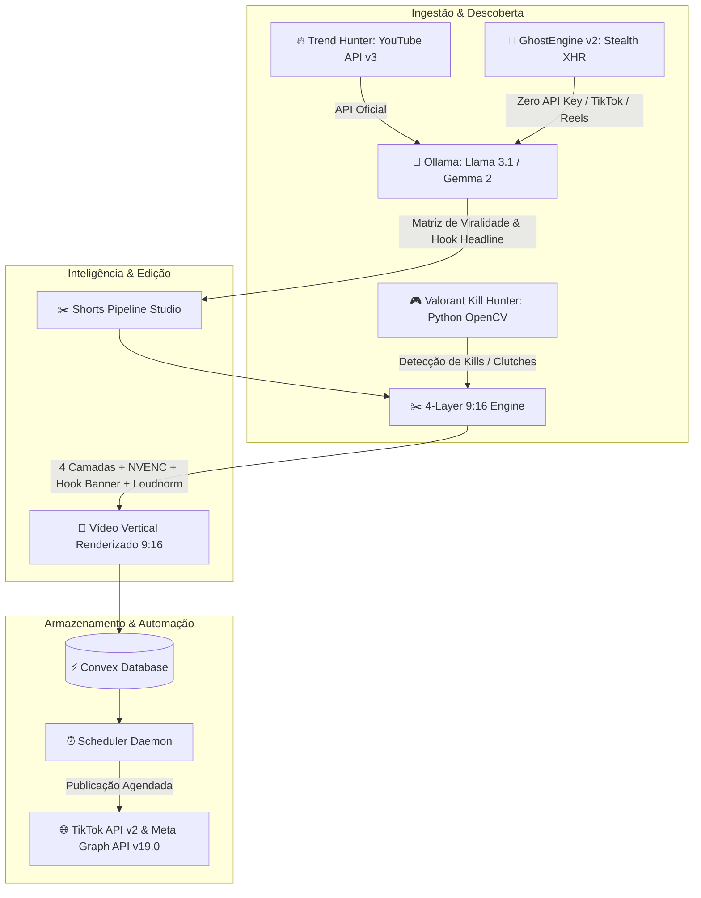

# 🚀 Limbo AI — Viral Studio & Intelligence Engine

> Plataforma completa de inteligência para conteúdo em vídeo, análise de tendências em tempo real, detecção por visão computacional de jogadas e automação de edição de cortes verticais de alto impacto (TikTok, YouTube Shorts e Instagram Reels) acelerada por GPU local (NVENC) e IA.

**Repositório Oficial:** [https://github.com/Emanuel565/limbo-ai](https://github.com/Emanuel565/limbo-ai.git)  
**Autor:** [Emanuel565](https://github.com/Emanuel565)  
**Tema Visual:** Deep Pink Luxury (`#14010e` com realces em rosa choque `#FF1493` e tipografia inspirada na Clínica Belvè)

---

## 🗺️ Visão Geral da Arquitetura



---

## ⚡ Principais Módulos

### 1. 🎮 Valorant Kill Hunter & 4-Layer 9:16 Editor (Visão Computacional & NVENC)
- **Detecção Inteligente de Jogadas (Python OpenCV):**
  - Script autônomo `tools/gameplay_kill_hunter.py` em ambiente virtual Python dedicado (`tools/.venv`).
  - Rastreamento dos ícones de eliminação e killfeed no canto superior direito.
  - Classificação de jogadas: **First Blood**, **Multi-Kill (2k/3k/4k)**, **Ace (5k)** e **Clutch**.
  - **Aceleração 3x em Momentos Mortos:** Rotações e caminhadas longas sem combate recebem aceleração dinâmica de 3x com badge visual `>> 3x`, mantendo o ritmo sem perder contexto.
- **Composição Visual em 4 Camadas (9:16 - 1080x1920):**
  - **Camada 1 (Fundo Dinâmico):** Vídeo original redimensionado para 360x640, com desfoque gaussiano suave (`boxblur=15:2`) e reescalado para 1080x1920, poupando até 70% de carga de CPU/GPU.
  - **Camada 2 (Jogabilidade Central):** Janela 1:1 (1080x1080) centralizada na mira com interpolação `lanczos` de máxima nitidez.
  - **Camada 3 (Tarja Superior de Retenção / Hook Headline):**
    - Quebra automática de linhas inteligentes (`splitHeadlineIntoLines`, máx. 26 caracteres por linha).
    - Evita corte ou transbordamento de texto nas laterais da tela (1080px de largura).
    - Centralização perfeita com fundo semitransparente escuro para contraste profissional.
  - **Camada 4 (Barra de Progresso e SubStation Alpha `.ass`):**
    - Barra inferior animada em rosa neon (`#FF1493`).
    - Legendas estilo Alex Hormozi com animação *pop* e ênfase nas palavras de choque.
- **Áudio Original 100% Preservado:**
  - O áudio original da gameplay (tiros, passos, comunicação e abates) permanece em volume total e sincronizado.
  - Trilha sonora BGM opcional aplicada com ducking suave sem abafar o jogo.

### 2. 👻 GhostEngine v2 & Trend Hunter Multiplataforma (Zero API Key)
- **Extração Resiliente Multi-Rede:**
  - **🔴 YouTube Trending:** Coleta de Top Charts e buscas sem consumir cotas da API do Google, interceptando requisições internas de `/youtubei/v1/browse`.
  - **🎵 TikTok Viral Spy:** Mineração de vídeos em alta, hashtags (#fyp, #viral) e áudios populares para orientar a trilha e o formato do corte.
  - **📸 Instagram Reels Explorer:** Descoberta de Reels de alto engajamento e sons originais em alta.
- **Os 7 Pilares Anti-Detecção Implementados:**
  1. **Singleton Browser com Auto-Recuperação:** Processo Chromium aquecido mantido em segundo plano.
  2. **Firewall de Recursos (Modo Texto):** Bloqueio cirúrgico de imagens, estilos e fontes, cortando 70% de banda.
  3. **Personas Coerentes:** Navegação com spoofing de hardware real (Win10/11, GPUs NVIDIA GTX/RTX, WebGL, ruído LCG de Canvas e fuso de São Paulo).
  4. **Pool de Abas Reutilizáveis:** Até 4 abas simultâneas que nunca morrem.
  5. **Intercepção XHR/Fetch:** Extração direta de payloads JSON antes do DOM.
  6. **Timing Humano (Box-Muller):** Distribuição log-normal com pico fisiológico em 250ms e retries exponenciais.
  7. **Semáforo de Concorrência & Cache TTL:** Cache em memória de 5 minutos (< 2ms de latência).

### 3. 📱 Agendamento, Fila Automática & Publicação Social
- **Scheduler Daemon Contínuo (`tools/scheduler-daemon.js`):**
  - Roda em segundo plano verificando a fila a cada 30 segundos.
  - Publica automaticamente os cortes aprovados no horário ideal programado.
- **Meta Graph API v19.0 (Instagram Reels):**
  - Criação de contêiner de mídia 9:16 (`POST /{ig-user-id}/media`), polling de processamento e publicação automatizada.
- **TikTok Content Posting API v2:**
  - Postagem direta de vídeos com tags algorítmicas (`POST /v2/post/publish/video/init/`), controle de privacidade, dueto e comentários.
- **Modal de Prévia 9:16:**
  - Visualização de alta fidelidade antes de aprovar a postagem, com títulos responsivos em até 2 linhas completas (`line-clamp-2 leading-snug break-words px-8`), sem cortes.

---

## 🛠️ Stack Tecnológica

| Camada | Tecnologia | Detalhes |
|---|---|---|
| **Frontend** | Next.js 15, React 19, TypeScript | Server Components, App Router, Lucide Icons, Tailwind CSS v4 |
| **Estilização** | Vanilla CSS + Tokens Belvè | `#14010e` base, `#FF1493` neon accents, glassmorphism de alta densidade |
| **Backend & Banco** | Convex Database & Functions | Sincronização em tempo real reativa para filas, agendamentos e status |
| **Processamento de Vídeo** | FFmpeg 9.0.2 Gyan Build | Aceleração por hardware NVENC (`h264_nvenc`), filtros ASS, loudnorm |
| **Visão Computacional** | Python 3.12 + OpenCV + NumPy | Detecção de abates e killfeed com aceleração local |
| **Inteligência Artificial** | Ollama local / Vercel AI SDK | Modelos `llama3.1:8b`, `gemma2:9b`, `qwen2.5-coder:7b` |
| **APIs Externas** | Google YouTube Data API v3 | Extração de métricas de engajamento, views, likes e charts |
| **Agendador** | Daemon nativo Node.js | Gerenciamento de tarefas em background resiliente com logs de execução |

---

## 💻 Como Executar Localmente

### Pré-requisitos
1. **Node.js 20+** instalado.
2. **Python 3.10+** instalado (para a visão computacional do Kill Hunter).
3. **FFmpeg** instalado com suporte a NVENC e libass (configurado no Windows via Gyan build).
4. **Ollama** rodando localmente na porta padrão `11434` (com o modelo `llama3.1:8b` ou `gemma2:9b`).

### Instalação

```bash
# 1. Clone o repositório
git clone https://github.com/Emanuel565/limbo-ai.git
cd limbo-ai

# 2. Instale as dependências Node.js
npm install

# 3. Configure o ambiente virtual Python para o Kill Hunter
python -m venv tools/.venv
tools\.venv\Scripts\pip install opencv-python numpy

# 4. Configure o arquivo de variáveis de ambiente
cp .env.example .env.local
```

### Variáveis de Ambiente (`.env.local`)

```env
# Convex Backend
CONVEX_DEPLOYMENT=seu_deployment_convex
NEXT_PUBLIC_CONVEX_URL=https://seu_deployment.convex.cloud

# YouTube Data API v3
YOUTUBE_API_KEY=sua_chave_do_google_cloud

# Ollama Local (GPU)
OLLAMA_BASE_URL=http://localhost:11434
OLLAMA_MODEL=llama3.1:8b
OLLAMA_FALLBACK_MODEL=qwen2.5-coder:7b

# TikTok Content Posting API v2 (Opcional para postagem real)
TIKTOK_ACCESS_TOKEN=seu_token_de_acesso_tiktok
TIKTOK_CREATOR_USERNAME=@seu_tiktok

# Meta Graph API v19.0 (Instagram Reels - Opcional para postagem real)
INSTAGRAM_ACCESS_TOKEN=seu_token_graph_api
INSTAGRAM_BUSINESS_ACCOUNT_ID=seu_instagram_account_id
INSTAGRAM_USERNAME=@seu_instagram
```

---

## 🚦 Inicialização Completa do Projeto

O comando `npm run dev` foi configurado para **iniciar todo o ecossistema simultaneamente** através do executável inteligente `tools/dev-runner.js`:

```bash
npm run dev
```

Esse comando inicializa em paralelo com prefixos coloridos no terminal:
1. **`[NEXT.JS]`**: Servidor Next.js com App Router e todas as rotas `/api/*` em `http://localhost:3000`.
2. **`[CONVEX]`**: Servidor de banco de dados e funções em tempo real do Convex (`convex dev`).
3. **`[DAEMON]`**: Daemon de publicação automática em segundo plano (`tools/scheduler-daemon.js`).

### Comandos Individuais (Caso deseje rodar isolado):

| Comando | Descrição |
|---|---|
| `npm run dev` | **Inicia tudo junto** (Next.js + Convex + Scheduler Daemon) |
| `npm run dev:front` | Inicia apenas o frontend Next.js e as APIs |
| `npm run dev:convex` | Inicia apenas o backend reativo do Convex |
| `npm run dev:daemon` | Inicia apenas o daemon de agendamento em background |
| `npm test` | Executa todos os 35 testes unitários e de integração |
| `npm run test:ghost` | Executa especificamente a suíte de testes do GhostEngine v2 |

Acesse a interface no navegador em: **`http://localhost:3000`**

---

## 📡 Catálogo de Rotas e APIs do Projeto

Todas as APIs rodam integradas sob o Next.js App Router e são inicializadas automaticamente pelo `npm run dev`:

### 🎮 Gameplay & Edição 9:16
- **`POST /api/valorant-cutter/analyze`**:
  - Recebe o caminho de uma gravação de gameplay VOD (`localFile` ou `sourceUrl`).
  - Executa o rastreador de abates `tools/detector_kills.py` com visão computacional OpenCV.
  - **🛡️ Regra Anti-Mata-Mata**: Filtra e descarta automaticamente qualquer clipe originado de Mata-Mata (Deathmatch / TDM) através de verificação dupla (presença obrigatória do HUD 5v5 com barra de agentes/cronômetro e habilidades + regra de cadência de rounds). Apenas partidas **Sem Classificação** ou **Competitivas** são aprovadas para cortes.
  - **📱 Auditoria do Agente de Social Media**: Cada jogada analisada passa obrigatoriamente pela chancela da IA de Social Media (`auditCutWithSocialMediaAI`), que avalia potencial viral (`viralScore`), retenção, checklist de jogada (ACE/4K/Clutch/3K) e duração ideal (8s a 58s). Apenas cortes aprovados recebem `aiApproval.status = 'APPROVED'`.
  - Retorna a lista de jogadas detectadas com badges de aprovação, durações, timestamps e scores virais.
- **`POST /api/valorant-cutter/render`**:
  - **🔒 Portão de Segurança Social Media**: Apenas cortes previamente aprovados pela auditoria de Social Media (`APPROVED`) são autorizados para renderização. Qualquer jogada reprovada ou não auditada é bloqueada.
  - Recebe a lista de jogadas selecionadas, layout de preferência, texto de hook e opções de áudio.
  - Executa o pipeline de 4 camadas via `tools/valorant-4layer-editor.js` com aceleração NVENC (`h264_nvenc`).
  - Realiza a quebra de linha de títulos longos para evitar transbordamento.
  - Salva o arquivo pronto para redes sociais na pasta `cortes_prontos/`.
- **`GET /api/gameplay-watcher` / `POST /api/gameplay-watcher`**:
  - Monitora o diretório de gravações locais para detecção de novas gameplays salvas e dispara o pré-processamento.

### 📅 Agendamento, Banco Permanente & Publicação Social
- **`GET /api/schedule`**: Lista os cortes agendados e publicados no banco permanente, organizados por **semanas com datas e horários nobres de engajamento** (`groupedWeeks`), status por canal (TikTok, Instagram Reels e YouTube Shorts) e ocupação de disco no SSD.
- **`POST /api/schedule`**: Agenda um novo corte renderizado para publicação multiplataforma (TikTok, Instagram Reels e YouTube Shorts via GhostEngine) ou executa a ação `{ action: "cleanup_disk" }` para liberar espaço no SSD excluindo arquivos `.mp4` pesados de posts já publicados enquanto preserva 100% dos dados, links e métricas no banco.
- **`PATCH /api/schedule`**: Atualiza a aprovação da IA, título, tags ou status de um post na fila.
- **`DELETE /api/schedule`**: Cancela um post agendado ou limpa a fila.

### 🤖 Inteligência & Tendências
- **`GET /api/trending-hashtags`**: Retorna as hashtags mais em alta no nicho de Valorant (Brasil e Global) com volume de visualizações rastreadas, velocidade de crescimento, clusters otimizados por jogada (ACE, 4K, Clutch, 3K) e diretrizes algorítmicas de retenção.
- **`POST /api/trending-hashtags`**: Gera um cluster customizado de hashtags equilibrado (Tags Amplas + Comunidade BR + Gatilho da Jogada + Branding do Jogador) para TikTok, Instagram Reels ou YouTube Shorts.
- **`POST /api/social-media-agent`**: Diagnóstico de perfil social, cálculo de viral score e recomendação de melhores horários de postagem.
- **`POST /api/chat`**: Interface de chat com IA local (Ollama) para assistência em criação de títulos e ganchos de retenção.

---

## 🛡️ Licença & Propriedade

Desenvolvido exclusivamente por **Emanuel565** para o ecossistema **Limbo AI**.  
Todos os direitos reservados.
