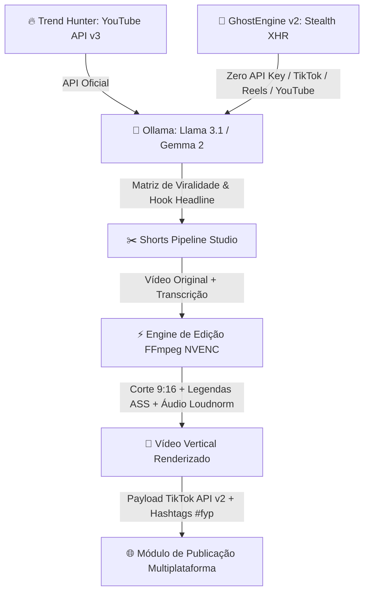

# 🚀 Limbo AI — Viral Studio & Intelligence Engine

> Plataforma completa de inteligência para conteúdo em vídeo, análise de tendências em tempo real e automação de edição de cortes verticais de alto impacto (TikTok, YouTube Shorts e Instagram Reels) acelerada por GPU local e IA.

**Repositório Oficial:** [https://github.com/Emanuel565/limbo-ai](https://github.com/Emanuel565/limbo-ai.git)  
**Autor:** [Emanuel565](https://github.com/Emanuel565)  
**Tema Visual:** Deep Pink Luxury (`#14010e` com realces em rosa choque `#FF1493` e tipografia inspirada na Clínica Belvè)

---

## 🗺️ Visão Geral da Arquitetura



---

## ⚡ Principais Módulos

### 1. 👻 GhostEngine v2 & Trend Hunter Multiplataforma (Zero API Key)
- **Extração Resiliente Multi-Rede:**
  - **🔴 YouTube Trending:** Coleta de Top Charts e buscas sem consumir cotas da API do Google, interceptando requisições internas de `/youtubei/v1/browse`.
  - **🎵 TikTok Viral Spy:** Mineração de vídeos em alta, hashtags (#fyp, #viral) e áudios populares para orientar a trilha e o formato do corte.
  - **📸 Instagram Reels Explorer:** Descoberta de Reels de alto engajamento e sons originais em alta.
- **Os 7 Pilares Anti-Detecção Implementados:**
  1. **Singleton Browser com Auto-Recuperação:** Processo Chromium aquecido mantido em segundo plano.
  2. **Firewall de Recursos (Modo Texto):** Bloqueio cirúrgico de imagens, estilos e fontes, cortando 70% de banda.
  3. **Personas Coerentes:** Navegação com spoofing de hardware real (Win10/11, GPUs NVIDIA GTX/RTX, WebGL, ruído LCG de Canvas e fuso de São Paulo).
  4. **Pool de Abas Reutilizáveis:** Até 4 abas simultâneas que nunca morrem.
  5. **Intercepção XHR/Fetch:** Extração direta de payloads JSON antes do DOM.
  6. **Timing Humano (Box-Muller):** Distribuição log-normal com pico fisiológico em 250ms e retries exponenciais.
  7. **Semáforo de Concorrência & Cache TTL:** Cache em memória de 5 minutos (< 2ms de latência).
- **Matriz Psicológica da IA Local (Ollama):** O modelo avalia cada vídeo através de 4 dimensões científicas de retenção:
  1. **Curiosity Gap (Lacuna de Curiosidade):** Grau de mistério gerado nos primeiros segundos.
  2. **Pattern Interrupt (Quebra de Padrão):** Capacidade de interromper o scroll do usuário.
  3. **Emotional Resonance (Impacto Emocional):** Força emocional e conexão imediata.
  4. **Shareability Factor (Potencial de Compartilhamento):** Propensão a ser enviado para terceiros.
- **Botão "Usar no Editor":** Transfere o vídeo vencedor, a transcrição e a headline diretamente para o estúdio de renderização com um clique.

### 2. 🎬 Engine de Edição Vertical de Alta Precisão (GPU NVENC)
- **Reenquadramento Automático 9:16 (1080x1920):** Conversão de formatos horizontais para corte vertical centralizado usando interpolação `lanczos` de alta definição.
- **Aceleração por Hardware (NVIDIA RTX 3060 Ti):** Codificação via `h264_nvenc` com preset de alta qualidade (`-preset p6 -tune hq -cq 19 -b:v 10M -maxrate 16M`).
- **Tarja Superior Fixa (*Hook Headline*):** Banner superior estilizado desenhado via FFmpeg `drawbox` + `drawtext` para reter o público logo no início do vídeo.
- **Legendas Dinâmicas em SubStation Alpha (`.ass`):**
  - Blocos curtos de 2 a 3 palavras no ritmo da fala (estilo Alex Hormozi).
  - Animação de escala *pop* (`\t(0,90,\fscx108\fscy108)`).
  - Realce automático de palavras de choque e números com a cor rosa choque **`#FF1493`**.
  - Queima direta das legendas no vídeo (*burn-in*) sem desincronia de tempo.
- **Barra de Progresso de Retenção:** Linha inferior animada em rosa neon (`#FF1493`) que indica a evolução do corte, estimulando o espectador a assistir até o fim.
- **Cadeia de Áudio de Podcast:**
  - `highpass=f=80`: Eliminação de ruídos subsônicos e batidas de microfone.
  - `afftdn=nf=-25`: Redução espectral inteligente de ruído de fundo.
  - `acompressor`: Nivelamento e punch dinâmico vocal.
  - `loudnorm=I=-14:LRA=7:TP=-1.5`: Normalização profissional no padrão EBU R128 (-14 LUFS).

### 3. 📱 Conexão de Contas, Análise e Publicação via API (TikTok & Instagram Reels)
- **Gerenciador de Contas Sociais:**
  - Suporte a contas vinculadas do **TikTok** (`@seu_tiktok`) e **Instagram** (`@seu_instagram`).
  - **Nova Função de Análise Preditiva & Auditoria de Algoritmo:**
    - Diagnóstico de **Score de Viralidade** (0-100) para cada rede.
    - Identificação dos **Melhores Horários para Postar** (ex: 11:30h, 17:15h e 20:45h) com base nos picos de engajamento.
    - Recomendações em tempo real da IA para otimização de retenção nos primeiros 3 segundos.
- **Publicação Direta por Meio de API:**
  - **Meta Graph API v19.0 (Instagram Reels):**
    - Criação de contêiner de mídia 9:16 (`POST /{ig-user-id}/media`), polling de processamento e publicação automatizada (`POST /{ig-user-id}/media_publish`).
  - **TikTok Content Posting API v2:**
    - Postagem direta de vídeos com tags algorítmicas (`POST /v2/post/publish/video/init/`), controle de privacidade, dueto e comentários.
  - **Disparo com 1 Clique:**
    - O vídeo renderizado no motor vertical é transmitido diretamente para a publicação social com geração instantânea de legendas e tags (#fyp, #viral, #reels).


---

## 🛠️ Stack Tecnológica

| Camada | Tecnologia | Detalhes |
|---|---|---|
| **Frontend** | Next.js 15, React 19, TypeScript | Server Components, Hooks reativos, Tailwind CSS v4 |
| **Estilização** | Vanilla CSS + Tokens Belvè | `#14010e` base, `#FF1493` neon accents, glassmorphism |
| **Processamento de Vídeo** | FFmpeg 9.0.2 Gyan Build | Aceleração por hardware NVENC, filtros ASS, loudnorm, lanczos |
| **Inteligência Artificial** | Ollama local / Vercel AI SDK | Modelos `llama3.1:8b`, `gemma2:9b`, `qwen2.5-coder:7b` |
| **APIs Externas** | Google YouTube Data API v3 | Extração de métricas de engajamento, views, likes e charts |
| **Testes** | Node.js Test Runner nativo | Testes unitários com `node --test` e sem dependências pesadas |

---

## 💻 Como Executar Localmente

### Pré-requisitos
1. **Node.js 20+** instalado.
2. **FFmpeg** instalado com suporte a NVENC e libass (já configurado no Windows via Gyan build).
3. **Ollama** rodando localmente na porta padrão `11434` (com o modelo `llama3.1:8b` ou `gemma2:9b`).

### Instalação

```bash
# 1. Clone o repositório
git clone https://github.com/Emanuel565/limbo-ai.git
cd limbo-ai

# 2. Instale as dependências
npm install

# 3. Configure o arquivo de variáveis de ambiente
cp .env.example .env.local
```

### Variáveis de Ambiente (`.env.local`)

```env
# YouTube Data API v3
YOUTUBE_API_KEY=sua_chave_do_google_cloud

# Ollama Local (GPU)
OLLAMA_BASE_URL=http://localhost:11434
OLLAMA_MODEL=llama3.1:8b
OLLAMA_FALLBACK_MODEL=qwen2.5-coder:7b

# TikTok Content Posting API v2 (Opcional para postagem real)
TIKTOK_ACCESS_TOKEN=seu_token_de_acesso_tiktok
TIKTOK_CREATOR_USERNAME=@seu_tiktok

# Meta Graph API v19.0 (Instagram Reels - Opcional para postagem real)
INSTAGRAM_ACCESS_TOKEN=seu_token_graph_api
INSTAGRAM_BUSINESS_ACCOUNT_ID=seu_instagram_account_id
INSTAGRAM_USERNAME=@seu_instagram
```

### Executando o Projeto

```bash
# Iniciar o servidor de desenvolvimento
npm run dev

# Executar todos os testes (Pipeline de Vídeo, Trend Hunter, Publicador Social e GhostEngine)
npm test

# Executar especificamente a suíte de testes do GhostEngine v2
npm run test:ghost
```

Acesse a interface no navegador em: **`http://localhost:3000`**

---

## 🔮 Roadmap: Como Levar a Edição de Vídeo ao Nível Máximo (CapCut / Opus Clip)

Para transformar o motor atual em uma solução industrial autônoma de edição comparável às melhores ferramentas do mercado mundial, recomendamos as seguintes integrações:

### 1. Sincronização de Legendas por Palavra (*Word-Level Timestamps*)
- **Ferramenta:** `whisper.cpp` ou `faster-whisper` (Python/C++ via CUDA).
- **Impacto:** Permite sincronização milimétrica palavra por palavra. Com isso, o efeito karaoke no formato `.ass` acende o rosa `#FF1493` exatamente no milissegundo em que cada sílaba é pronunciada pelo locutor.

### 2. Enquadramento Facial Inteligente (*Auto-Reframe com Detecção Facial*)
- **Ferramenta:** `mediapipe` (Google) ou `opencv4nodejs`.
- **Impacto:** Atualmente, o vídeo 9:16 faz um corte central `(iw-1080)/2`. Com rastreamento facial ativo, a janela horizontal de 1080px se move suavemente (*smooth panning*) acompanhando o rosto de quem está falando, eliminando qualquer risco de cortar o interlocutor para fora do enquadramento.

### 3. Remoção Automática de Silêncios e Respirações (*Auto Jumpcut*)
- **Ferramenta:** Filtro `silencedetect` do FFmpeg ou `Silero VAD`.
- **Impacto:** Corta automaticamente pausas sem fala superiores a 300ms. Esse corte seco contínuo acelera o ritmo do vídeo e pode elevar a retenção de tela em até 35% no TikTok e no Shorts.

### 4. Overlays Programáticos com Remotion
- **Ferramenta:** `@remotion/core` e `@remotion/cli`.
- **Impacto:** Permite desenhar templates de vídeo completos usando componentes React: efeitos de zoom elástico (*spring physics*), stickers animados, caixas de perguntas do Instagram e transições de tela cinemáticas com aceleração pela GPU.

### 5. Inserção Automática de B-Rolls Contextuais
- **Ferramenta:** Pexels API / Pixabay API integrada à IA.
- **Impacto:** O Ollama identifica conceitos-chave na transcrição (ex: "inteligência artificial", "dinheiro", "gráfico caindo") e insere pequenos vídeos de cobertura (*B-rolls*) de 2 segundos com transição rápida e opacidade reduzida sobre o vídeo principal.

### 6. Ducking de Trilha Sonora e Efeitos Sonoros (SFX)
- **Ferramenta:** Filtro `sidechaincompress` do FFmpeg.
- **Impacto:** Aplica uma música instrumental viral de fundo em volume baixo que se reduz automaticamente (*audio ducking*) sempre que o locutor fala, somada a pequenos efeitos de "whoosh" e "pop" nas trocas de legenda.

---

## 🛡️ Licença & Propriedade

Desenvolvido exclusivamente por **Emanuel565** para o ecossistema **Limbo AI**.  
Todos os direitos reservados.
