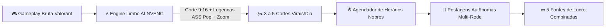

# 💰 Blueprint de Monetização & Fábrica Autônoma de Valorant
## Projeto: Limbo AI (`Emanuel565/limbo-ai`)
### Objetivo: Gerar Lucro em Escala Automatizada com Cortes de Valorant (YouTube, TikTok & Instagram)

---

## 1. 🚀 Visão Geral: A Máquina de Impressão de Atenção & Lucro

Transformar gameplays de **Valorant** em uma **fábrica autônoma de receita recorrente** é uma das estratégias de maior margem no mercado de conteúdo digital atual. Games competitivos possuem:
1. **Audiência Viciada e Fiel:** Jovens de 14 a 30 anos passam de 4 a 8 horas por dia jogando e consumindo conteúdo de Valorant.
2. **Alto Desejo de Consumo:** O público gasta constantemente em skins, passes de batalha, mouses ultraleves, teclados magnéticos, mousepads speed e VPNs gamer (ExitLag).
3. **Padrões de Viralidade Claros e Replicáveis:** Clutches 1v5, jogadas de 1 HP, miras de pro players (Aspas, TenZ) e lineups secretas geram picos instantâneos de retenção.

Com o **Limbo AI**, o processo deixa de ser manual e se torna um **Admin Autônomo**:

---

## 2. 📊 Análise Detalhada de Monetização por Rede Social

### 🔴 YouTube (Shorts + Compilados Semanais Longos)
* **Monetização Direta de Shorts (YPP - YouTube Partner Program):**
  * **RPM Médio de Shorts:** R$ 0,15 a R$ 0,45 por 1.000 visualizações (média de R$ 0,30).
  * 1 milhão de views de Shorts = **~R$ 300 a R$ 450**.
* **O "Segredo de Ouro" do YouTube: O Compilado Longo:**
  * O Shorts é apenas o **topo de funil** para atrair 10.000 a 30.000 inscritos por mês.
  * O robô compila automaticamente os 10 melhores cortes da semana em 1 vídeo longo horizontal de 8 a 12 minutos: *"OS MELHORES CLUTCHES DE VALORANT DA SEMANA #12"*.
  * **RPM Médio de Vídeo Longo Gamer:** **R$ 12,00 a R$ 28,00 por 1.000 visualizações** (média de R$ 18,00).
  * 1 compilado semanal com 50.000 views = **~R$ 900,00**. Quatro compilados no mês = **~R$ 3.600,00 só com vídeos longos** gerados a partir dos mesmos cortes!

---

### 🎵 TikTok (Creator Rewards + TikTok Shop + Afiliados)
* **Programa de Recompensas do Criador (Creator Rewards):**
  * Para vídeos de 60 segundos ou mais, o RPM é muito superior: **R$ 2,20 a R$ 6,50 por 1.000 visualizações qualificadas** (média de R$ 3,80).
  * **Estratégia do Limbo AI:** Cortes de rounds inteiros com storytelling ("1 HP no overtime com a Spike plantada...") estruturados para durar entre 60s e 75s para destravar o teto máximo de pagamento do TikTok.
  * 1 milhão de views qualificadas no TikTok = **~R$ 2.200 a R$ 4.500**.
* **TikTok Shop & Afiliados de Vitrine:**
  * Fixar na vitrine e nos comentários mouses populares (ex: *Attack Shark X3, Razer DeathAdder, Logitech G PRO*).
  * Comissões de 10% a 20% por venda sem estoque.

---

### 📸 Instagram Reels (O Campeão de Conversão em Vendas e Parcerias)
* Embora o Instagram não pague AdSense de visualizações consistente no Brasil, ele é **a rede social onde as marcas mais pagam dinheiro real por publicidade**.
* **1. Parcerias & Publiposts de Marcas Gamers:**
  * Perfis de nicho gamer ativo no Reels com 30k a 100k seguidores cobram entre **R$ 800 e R$ 3.500 por vídeo patrocinado** (marcas de energéticos como Overclock e Monster, marcas de periféricos como Redragon, Fallen Gear e lojas de PC Gamer).
* **2. Renda Passiva Recorrente com ExitLag / NoPing:**
  * ExitLag e NoPing possuem programas de afiliados que pagam **comissão recorrente mensal em dólar (US$ 2.50 a US$ 3.50 por mês)** para cada jogador que assinar pelo seu link ou cupom.
  * Com 500 assinantes ativos conquistados ao longo de 4 meses: **500 × US$ 3.00 = US$ 1.500/mês (~R$ 8.250/mês recorrente sem fazer nada extra)**.
* **3. Afiliados de Periféricos de Pro Players (Amazon / Shopee / Kabum):**
  * Na bio e nos comentários: *"Quer a mira e o mouse do Aspas? Link dos periféricos recomendados na bio"*.
  * Gera de R$ 800 a R$ 2.500/mês em comissões de e-commerce.

---

## 3. 📈 Simulação Financeira: Quanto Podemos Lucrar?

Estimativa baseada na operação do **Admin Autônomo** postando **3 a 5 vídeos por dia nas 3 plataformas** simultaneamente.

| Métrica / Fonte de Receita | 🟢 Cenário 1: Start (Mês 1) | 🟡 Cenário 2: Tração (Mês 3) | 🟣 Cenário 3: Escala (Mês 6) |
|---|---|---|---|
| **Vídeos Postados no Mês** | 90 cortes (3/dia) | 120 cortes (4/dia) | 150 cortes (5/dia) |
| **Visualizações Totais Acumuladas** | ~600.000 views | ~3.500.000 views | ~12.000.000 views |
| **YouTube Shorts (AdSense)** | R$ 180,00 | R$ 950,00 | R$ 3.600,00 |
| **YouTube Compilados Semanais (10m)** | R$ 600,00 | R$ 3.200,00 | R$ 8.500,00 |
| **TikTok (Creator Rewards / Fundo)** | R$ 450,00 | R$ 2.800,00 | R$ 9.200,00 |
| **Afiliados de Periféricos Gamer** | R$ 390,00 | R$ 1.950,00 | R$ 6.800,00 |
| **ExitLag / VPN Recorrente (Dólar)** | R$ 240,00 | R$ 1.800,00 | R$ 7.500,00 |
| **Publiposts / Patrocínios no Instagram** | R$ 0,00 | R$ 1.500,00 | R$ 6.000,00 |
| **🔥 TOTAL MENSAL ESTIMADO** | **R$ 1.860,00** | **R$ 12.200,00** | **R$ 41.600,00** |
| **💵 Equivalente em Dólar (USD)** | **~US$ 338** | **~US$ 2.218** | **~US$ 7.563** |

---

## 4. ⚙️ Como a Fábrica Autônoma Opera no Projeto

A esteira de automação do Limbo AI foi estruturada para rodar de forma independente:

1. **Entrada de Gameplay:**
   - O usuário faz o upload da partida gravada (ou aponta o caminho local da pasta de gravações do OBS / ShadowPlay da NVIDIA).
2. **Geração em Lote de Cortes com Arquétipos Virais (`tools/valorant-autopilot.js`):**
   - A máquina seleciona os trechos de pico de adrenalina:
     - *Clutch 1v5 / 1 HP:* Gancho de sobrevivência milagrosa.
     - *Lineups Proibidas:* Dicas de utilitários que forçam o espectador a salvar o vídeo.
     - *Mira do Aspas:* Segredos de sensibilidade de pro player.
     - *Rage de Duo:* Ganchos que inflamam discussões nos comentários.
3. **Renderização Vertical Acelerada por GPU:**
   - Enquadramento 9:16 lanczos focado na mira central.
   - Legendas Pop no padrão Alex Hormozi com destaque em rosa choque (`#FF1493`).
   - Normalização de áudio em -14 LUFS para o som do jogo ficar limpo e encorpado.
   - Barra de retenção inferior animada.
4. **Agendamento Inteligente nos Picos Gamers:**
   - Os vídeos são programados automaticamente na fila (`data/scheduled-posts.json`) para os horários nobres de maior audiência:
     - **11:30h** (Almoço / início do intervalo escolar e de trabalho).
     - **17:15h** (Saída do trabalho / faculdade / transporte público).
     - **20:45h** (Pico de jogadores logados no Valorant).
     - **23:15h** (Late night scroll na cama antes de dormir).
5. **Publicação & Limpeza Automática:**
   - O daemon [`tools/scheduler-daemon.js`](file:///c:/Users/manuc/agentube-ai-agent/tools/scheduler-daemon.js) monitora a fila em segundo plano.
   - Dispara as postagens com as hashtags algorítmicas (`#valorant #valorantbrasil #clutch #vct #fyp`).
   - Exclui os arquivos temporários pós-publicação para preservar o armazenamento do SSD.

---

## 5. 🚀 Próximos Passos para o Lançamento

1. **Configurar as Contas:**
   - Criar e conectar as contas das 3 redes com estética unificada: `@LimboValorant` ou `@SeuNomeCortes`.
2. **Adicionar Links de Afiliados na Bio:**
   - Cadastrar-se no Programa de Associados da Amazon e no programa de afiliados da ExitLag.
   - Inserir um agregador de links limpo (Linktree ou Beacons) com o título: *"Mira do Aspas + Mouse Recomendado"*.
3. **Disparar a Fábrica:**
   - Subir a primeira partida no painel e clicar em **"Disparar Fábrica Autônoma"**.
   - Deixar o robô publicar de forma consistente todos os dias!
